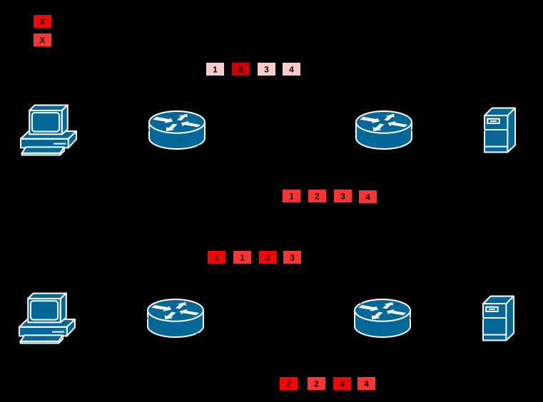
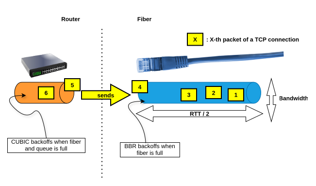

A Mininet simulation for packet spraying using BBRv3 as TCP congestion control and compare with the default CUBIC as a baseline.

# Background: ECMP versus packet spraying

# Background: CUBIC versus BBR

